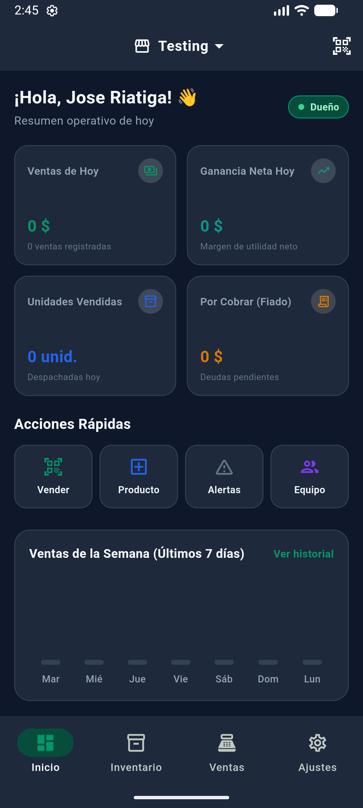
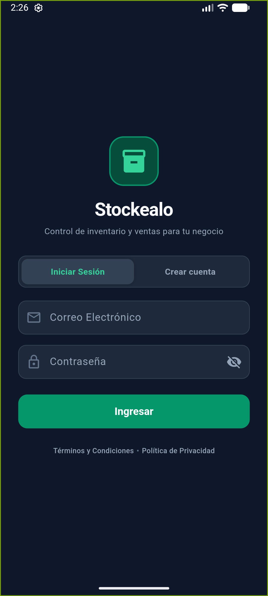
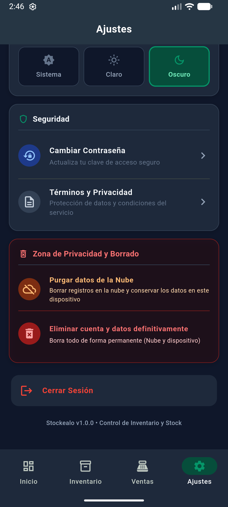
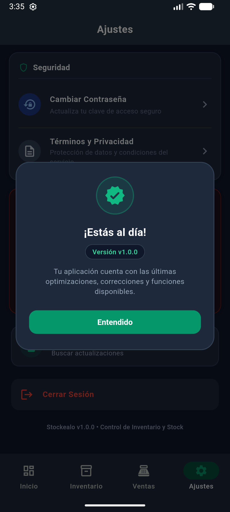

# 📦 Stockealo

### *Control inteligente de inventario, ventas y finanzas para tu negocio*

Una solución móvil ágil, potente y privada diseñada para comerciantes, tiendas y emprendimientos que necesitan gestionar sus operaciones diarias con total rapidez, fiabilidad y sin depender de conexión a internet.

---

## 📸 Vistas de la Aplicación

  <table>
    <tr>
      <td align="center" width="50%">
        <b>📊 Dashboard Operativo</b>  
        
      </td>
      <td align="center" width="50%">
        <b>🔐 Acceso y Seguridad</b>  
        
      </td>
    </tr>
    <tr>
      <td align="center" width="50%">
        <b>⚙️ Ajustes y Privacidad</b>  
        
      </td>
      <td align="center" width="50%">
        <b>🔄 Actualizaciones en Vivo</b>  
        
      </td>
    </tr>
  </table>

---

## ✨ Características Principales

### 📦 Gestión Completa de Inventario y Catálogo
- **Fichas detalladas de producto**: Nombre, foto, precio de compra, precio de venta, margen de ganancia y stock disponible.
- **Escaneo integrado**: Identificación instantánea de productos mediante lector de códigos de barras y códigos QR usando la cámara del dispositivo.
- **Alertas de reposición**: Notificaciones automáticas de productos agotados o próximos a agotarse según el stock mínimo configurado.
- **Valorización financiera**: Conoce en todo momento el valor exacto de tu mercancía invertida y su proyección de ventas.
- **Importación y Exportación masiva**: Compatible con plantillas de Microsoft Excel (`.xlsx`) para migrar o respaldar catálogos en segundos.

### 💳 Punto de Venta Rápido (POS)
- **Registro de transacciones en segundos**: Agrega productos por escáner o selección directa para cobrar sin demoras en mostrador.
- **Múltiples métodos de pago**: Soporte para efectivo, transferencias bancarias, tarjetas y ventas a crédito (fiado).
- **Cálculo de utilidad neta en vivo**: Cada venta calcula automáticamente el costo del producto vs. el valor cobrado, mostrando la ganancia real obtenida.

### 👥 Cartera de Clientes y Control de Fiados
- **Historial de deuda por cliente**: Lleva el registro exacto de quién te debe, cuánto te debe y cuándo compró.
- **Registro de abonos parciales**: Control de pagos con deducción automática del saldo pendiente y comprobante digital.
- **Contacto directo**: Acceso rápido para coordinar cobranzas o enviar detalles de cuenta por WhatsApp.

### 📊 Dashboard y Análisis Financiero
- **Resumen operativo diario**: Métricas en tiempo real de ventas del día, ganancia neta, unidades despachadas y cuentas pendientes de cobro.
- **Gráfica de rendimiento semanal**: Tendencias de ventas de los últimos 7 días para identificar los días de mayor movimiento comercial.

### 🏢 Multi-Negocio y Colaboradores
- **Múltiples empresas independientes**: Gestiona dos o más tiendas o sucursales de manera totalmente separada desde la misma cuenta.
- **Equipo de trabajo y cajeros**: Asigna colaboradores con perfiles de acceso específicos para operar la caja sin exponer información sensible.

### 🌙 Experiencia Visual de Alto Contraste
- **Modo oscuro nativo (WCAG)**: Interfaz optimizada en tonos pizarra y esmeralda de alto contraste para máxima legibilidad bajo cualquier condición de luz y menor consumo de batería durante largas jornadas de trabajo.

---

## 🛡️ Privacidad y Seguridad por Diseño (Offline-First)

Stockealo está construida bajo la filosofía **Offline-First**, lo que significa que el negocio nunca se detiene:

- **100% Funcional sin Internet**: Todas las operaciones, ventas y consultas se ejecutan directamente en la memoria local de tu dispositivo mediante SQLite cifrado.
- **Sincronización Opcional en la Nube**: Si decides activar el respaldo en la nube, tus datos se sincronizan de forma segura para permitir acceso multidispositivo.
- **Zona de Privacidad y Control de Datos**:
  - **Purgar la nube**: Borra las copias remotas de internet en cualquier momento y regresa al modo local privado, conservando el 100% de tus ventas y productos intactos en el dispositivo.
  - **Eliminación total**: Posibilidad de dar de baja la cuenta y suprimir todos los registros de forma definitiva conforme a normativas de protección de datos.

---

## 🔄 Actualizaciones Autónomas Integradas (OTA)

Stockealo cuenta con su propio canal de actualizaciones directas dentro de la aplicación:
- **Detección inteligente**: Notifica al usuario cuando existe una nueva versión con mejoras o nuevas herramientas.
- **Instalación segura sin pérdida de información**: La app descarga e instala la actualización sobreescribiendo el sistema sin afectar la base de datos local ni la sesión del usuario.

---

## 📄 Propiedad y Derechos de Autor

**Stockealo** es un software comercial propietario desarrollado por **Jose Riatiga**.

Todos los derechos sobre el código fuente, diseño, logotipos, arquitectura y marcas asociadas están estrictamente reservados conforme a la legislación internacional de propiedad intelectual. Consulta el archivo [LICENSE](LICENSE) para más detalles.

---

  © 2026 Jose Riatiga. Todos los derechos reservados.

