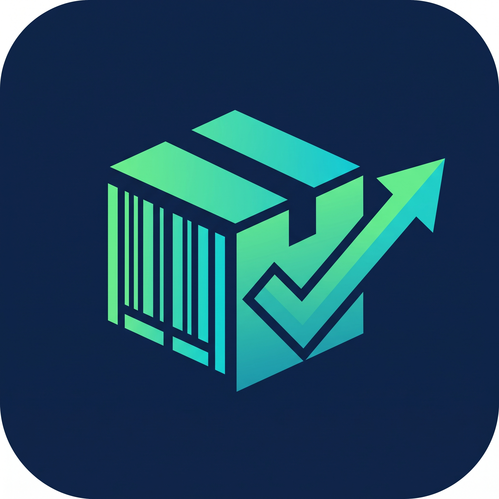
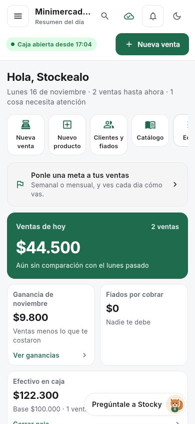
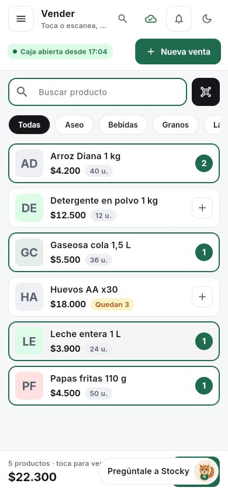
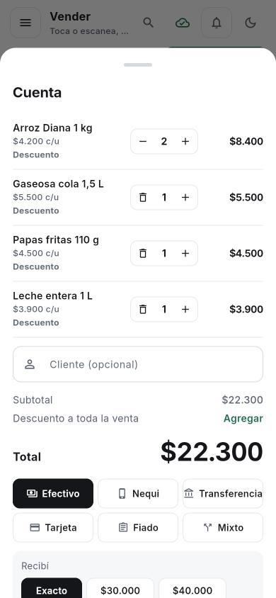
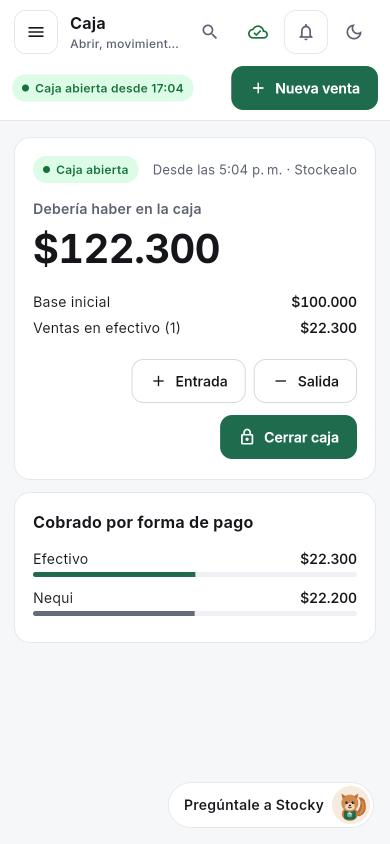
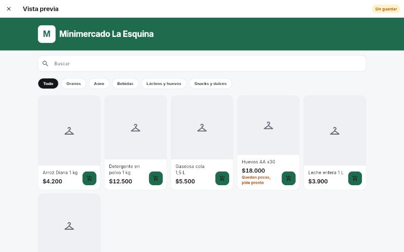
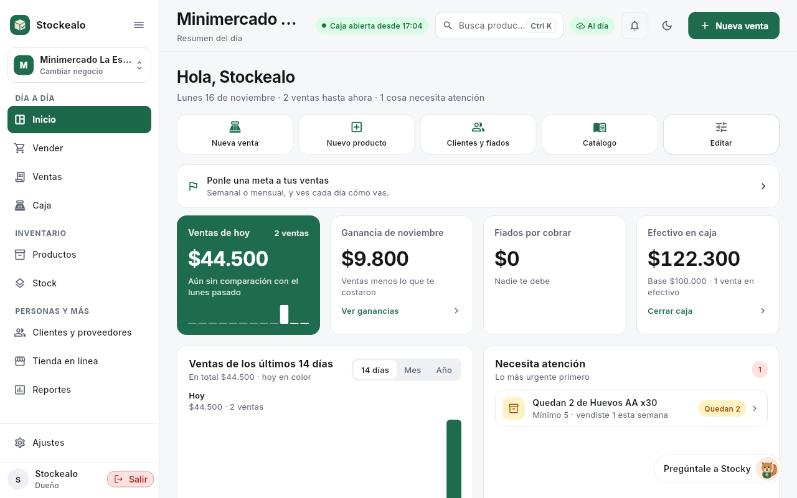

# Stockealo

**Inventario, ventas, caja, servicios y tienda en línea para negocios de barrio y emprendimientos.**

Funciona en el celular (Android) y en el navegador, con o sin internet.

[Usar en la web](https://stockealo.online/app/) · [Descargar para Android](https://github.com/JoseRiatiga/Stockealo/releases/latest) · [Cómo instalar](https://stockealo.online/instalar) · [stockealo.online](https://stockealo.online)

Versión actual: **0.16.2**

---

## Así se ve

<table>
  <tr>
    <td align="center"><b>Inicio</b>  </td>
    <td align="center"><b>Vender</b>  </td>
    <td align="center"><b>Cobrar</b>  </td>
  </tr>
  <tr>
    <td align="center"><b>Comprobante</b>  </td>
    <td align="center"><b>Caja</b>  </td>
    <td align="center"><b>Tienda en línea</b>  </td>
  </tr>
</table>

 En el computador, con el menú lateral.

---

## Qué hace

### Inventario
- Productos con foto, precio de compra y de venta, margen, marca y código de barras.
- Tallas, colores y otras variantes, cada una con su stock.
- Lotes con fecha de vencimiento: vende primero lo que vence antes y avisa lo vencido.
- Avisos de stock bajo, productos agotados y productos quietos.
- Plantillas por tipo de negocio: barrio, licorera, droguería, ropa, comidas y más.
- Importar desde Excel con vista previa, y catálogo en PDF.

### Ventas y caja
- Vender tocando o escaneando, con descuento por línea o a toda la venta.
- Efectivo, Nequi, transferencia, tarjeta, fiado y pago mixto.
- Comprobante para compartir por WhatsApp como imagen.
- Ventas en espera, cotizaciones y devoluciones parciales.
- Caja con base, entradas y salidas, cierre con conteo por billetes y lo cobrado por forma de pago.
- Promociones con fechas (porcentaje o 2×1).

### Clientes y proveedores
- Fiados y abonos por cliente, con recordatorio por WhatsApp.
- Proveedores, entradas de mercancía y cuentas por pagar.

### Reportes y metas
- Ganancia neta por día, semana, mes o año, con lo que se perdió y por qué.
- Metas de ventas semanales o mensuales con su avance.
- Cierre del día por WhatsApp y descarga en Excel.

### Tienda en línea
- Catálogo con carrito: el cliente pide y el pedido llega a la app y por WhatsApp.
- Plantillas Clásica, Moda, Mercado, Menú y Boutique, con color propio y modo oscuro.
- Horario de atención, destacados, cupones de descuento y estadísticas de visitas.
- Piezas para Instagram, QR de la tienda y enlace para compartir cada producto.

### Servicios (Pro Servicios)
- Para lavaderos, barberías, peluquerías, talleres y lavanderías.
- Tablero de órdenes, agenda y reservas en línea.
- Empleados con horario, comisiones y alquiler de silla.

### Equipo
- Varios negocios en la misma cuenta.
- Roles con permisos (dueño, administrador, cajero o uno propio) y horario de acceso.
- El cajero no ve costos ni ganancias.

### Stocky
- Asistente con IA que responde sobre el negocio y lleva a cada función.

---

## Privacidad y seguridad

- **Funciona sin internet.** Todo se guarda primero en el equipo y se sube a la nube cuando vuelve la conexión.
- **Copia en la nube** para usar el mismo negocio en varios equipos.
- **Bloqueo con PIN o huella** en el celular.
- **Entrar con correo o con Google.**
- **Descargar todos tus datos** en Excel y **eliminar la cuenta** cuando quieras.

---

## Planes

- **Gratis:** inventario, ventas, caja, clientes, proveedores, reportes y metas del negocio.
- **Pro:** tienda en línea, catálogos, metas por persona y límites por empleado.
- **Pro Servicios:** el módulo de servicios para lavaderos, barberías y talleres.

Los precios se consultan en la app.

---

## Propiedad y derechos de autor

**Stockealo** es software comercial propietario desarrollado por **Jose Riatiga**. Todos los derechos sobre el código, el diseño, los logotipos y las marcas están reservados. Consulta [LICENSE](LICENSE).

  © 2026 Jose Riatiga. Todos los derechos reservados.

